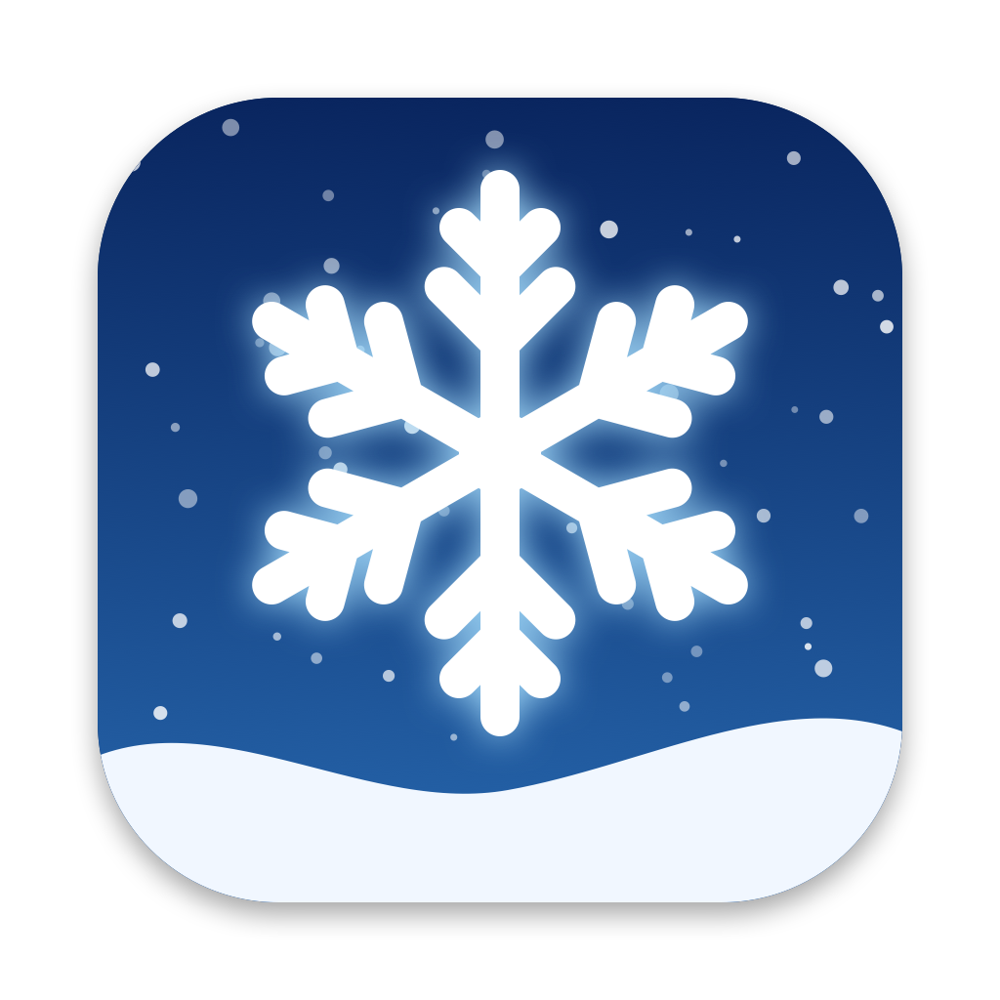

<p align="center">
  
</p>

<h1 align="center">❄️ Новогодний снег для Mac</h1>

<p align="center">
  Праздничное оформление macOS: снег на рабочем столе, сугробы на окнах и Доке,<br>
  гирлянды, сосульки, салют, Санта с подарками и рождественская музыка.
</p>

<p align="center">
  <a href="https://daniiltur24.github.io/NewYearSnow/"><b>🌐 Страница программы с установкой по шагам</b></a>
  &nbsp;·&nbsp;
  <a href="https://github.com/DaniilTur24/NewYearSnow/releases/latest/download/NewYearSnow.dmg"><b>⬇️ Скачать NewYearSnow.dmg</b></a>
</p>

---

## Что умеет

- 🌨 **Снег на рабочем столе.** Падает на фоне и не мешает работать в окнах.
- 🏔 **Сугробы на окнах и на Доке.** Их можно сбивать курсором, а если резко дёрнуть окно, снег с него слетит.
- 🧊 **Сосульки** под сугробами. Если задеть курсором, падают и разбиваются со звоном.
- 💡 **Гирлянды.** Одна висит по верхнему краю экрана, вторая лежит на сугробе внизу и на Доке.
- 🎛 **Три режима зимы:** лёгкий, средний и максимальный (настоящая метель).
- 🎆 **Салют.** Двойной клик по пустому рабочему столу, а в полночь 31 декабря большой салют с поздравлением.
- 🎅 **Санта на оленях** иногда пролетает по экрану и роняет подарки. Ловите их курсором!
- 🎵 **Рождественская музыка** в стиле музыкальной шкатулки: пять мелодий, включается в меню.
- ⏳ **Таймер до Нового года** рядом со снежинкой в строке меню.
- 📅 **Сам выключается после 15 января** и снова включается 1 ноября.

Всё управление в меню **❄️** в строке меню, вверху справа.

## Требования

- macOS 14 Sonoma или новее
- Любой Mac: и на Apple Silicon (M1–M4), и на Intel

---

## Установка (5 минут, без программирования)

> Проще всего установить через **[страницу программы](https://daniiltur24.github.io/NewYearSnow/)**: после нажатия «Скачать» она покажет каждый шаг с картинками.

Программа бесплатная и не подписана платным сертификатом Apple, поэтому при первом запуске macOS её не пустит. Это нормально, и обойти это нужно **один раз**.

### 1. Скачайте и перетащите

1. Скачайте **[NewYearSnow.dmg](https://github.com/DaniilTur24/NewYearSnow/releases/latest/download/NewYearSnow.dmg)**.
2. Откройте скачанный файл. Появится окно со значком программы.
3. Перетащите **NewYearSnow** на папку **«Программы (Applications)»** в том же окне.

### 2. Разрешите запуск

1. Откройте папку **«Программы»** и дважды щёлкните по **NewYearSnow**.
2. macOS напишет, что не может проверить программу. Нажмите **«Готово»** (не «Переместить в корзину»).
3. Откройте **  → Системные настройки → Конфиденциальность и безопасность**.
4. Прокрутите вниз до раздела **«Безопасность»**. Там будет строка про NewYearSnow и кнопка **«Всё равно открыть»**. Нажмите её и подтвердите паролем или Touch ID.
5. Ещё раз нажмите **«Всё равно открыть»** в появившемся окне.

Готово: вверху справа в строке меню появится **❄️**, и пойдёт снег. Программа сама откроет окно, где шаги 3 и 4 делаются одной кнопкой.

> На macOS 14 Sonoma можно проще: щёлкните по программе **правой кнопкой → «Открыть» → «Открыть»**.

### 3. Снег на Доке и вкладках (по желанию)

Чтобы сугроб и гирлянда легли на Док, программе нужно узнать, где он находится. Нажмите **«Открыть настройки»** в окне приветствия (или меню ❄️ → «Как настроить…») и включите переключатель:

**Системные настройки → Конфиденциальность и безопасность → Универсальный доступ** → включите **NewYearSnow**.

Программа только смотрит, где находятся Док и вкладки. Она ничего не нажимает и никуда ничего не отправляет.

### 4. Автозапуск (по желанию)

Чтобы снег включался сам при включении Mac, нажмите **«Включить»** в окне приветствия. Или вручную:

**Системные настройки → Основные → Объекты входа** → в разделе «Открывать при входе» нажмите **«+»** и выберите **NewYearSnow**.

### Названия настроек на других языках

| Русский | English | Deutsch |
|---|---|---|
| Системные настройки | System Settings | Systemeinstellungen |
| Конфиденциальность и безопасность | Privacy & Security | Datenschutz & Sicherheit |
| Всё равно открыть | Open Anyway | Dennoch öffnen |
| Универсальный доступ | Accessibility | Bedienungshilfen |
| Объекты входа | Login Items | Anmeldeobjekte |
| Программы | Applications | Programme |

---

## Как пользоваться

Щёлкните по **❄️** в строке меню:

| Пункт | Что делает |
|---|---|
| **Лёгкий / Средний / Максимальный** | Сколько снега, какие сугробы и сосульки. Максимальный — метель с ветром. |
| **Сугробы на окнах** | Включить или выключить сугробы и сосульки на окнах. |
| **Позвать Санту 🎅** | Санта прилетит прямо сейчас (иначе раз в 40–70 минут). |
| **Запустить салют 🎆** | Три ракеты салюта. |
| **Музыка 🎵** | Рождественская музыка. Пока она играет, в меню видно название мелодии и кнопку «Следующая». |
| **Как настроить…** | Окно с доступом к Доку и автозапуском. |
| **Выход** | Выключить программу. |

Ещё можно:
- **провести курсором по сугробу**, и снег слетит комьями;
- **задеть сосульку**, и она упадёт;
- **резко дёрнуть окно** за заголовок, и с него слетит весь снег;
- **дважды щёлкнуть по пустому рабочему столу**, и будет салют;
- **ловить курсором подарки**, которые роняет Санта.

---

## Если что-то не получается

**Самый простой способ:** скопируйте текст ниже, вставьте в ChatGPT (или любой другой ИИ-чат), допишите в конце, что именно не получается, и следуйте ответу.

```text
Помоги мне установить бесплатную программу NewYearSnow на Mac
(страница программы: https://github.com/DaniilTur24/NewYearSnow).
Я скачал файл NewYearSnow.dmg. Объясни по шагам и простыми словами:
1) как перетащить программу в папку «Программы»;
2) как открыть её, если macOS пишет, что не может проверить программу
   (через Системные настройки → Конфиденциальность и безопасность → «Всё равно открыть»);
3) как выдать ей разрешение «Универсальный доступ», чтобы снег был на Доке.
Я не программист. Моя версия macOS: (посмотреть:  → Об этом Mac).
Вот что у меня не получается:
```

**Частые вопросы:**

<details>
<summary>Нет кнопки «Всё равно открыть»</summary>

Сначала попробуйте открыть программу двойным щелчком: кнопка появляется только после такой попытки, и она видна примерно час. Если её всё равно нет, откройте **Терминал** (Программы → Утилиты → Терминал), вставьте эту команду и нажмите Enter:

```bash
xattr -dr com.apple.quarantine /Applications/NewYearSnow.app
```

Команда снимает с программы пометку «скачано из интернета». После этого программа откроется обычным двойным щелчком.
</details>

<details>
<summary>Не видно ❄️ в строке меню</summary>

Если значков в строке меню много, на MacBook с «чёлкой» часть из них прячется за вырезом экрана. Зажмите **⌘ Cmd** и перетащите несколько других значков из строки меню вниз, чтобы освободить место.
</details>

<details>
<summary>Нет снега и гирлянды на Доке</summary>

Выдайте разрешение **«Универсальный доступ»** (шаг 3 установки). Если NewYearSnow уже есть в списке с включённым переключателем, но снега нет, удалите программу из списка кнопкой **«−»** и выдайте разрешение заново.
</details>

<details>
<summary>Программа не тормозит Mac?</summary>

Нет. Снег рисует видеокарта, программа занимает 2–6% одного ядра процессора. В максимальном режиме нагрузка чуть выше.
</details>

<details>
<summary>Это безопасно?</summary>

Весь код открыт и лежит в этом репозитории. Программа не ходит в интернет и не собирает никаких данных. Разрешение «Универсальный доступ» нужно только для того, чтобы узнать, где на экране Док и вкладки.
</details>

<details>
<summary>Как удалить</summary>

1. Меню **❄️ → Выход**.
2. Перетащите **NewYearSnow** из папки «Программы» в корзину.
3. По желанию уберите программу из «Универсального доступа» и «Объектов входа» в Системных настройках.
</details>

---

## Для разработчиков

Программа написана на Swift (AppKit и Core Animation), без Xcode-проекта и сторонних библиотек.

```bash
xcode-select --install   # инструменты командной строки Apple, если их нет
./build.sh               # → build/NewYearSnow.app (Apple Silicon + Intel)
./make-dmg.sh            # → dist/NewYearSnow.dmg (оформленное окно; Finder попросит разрешение на управление)
./tools/make-icon.sh     # пересобрать иконку
```

| Файл | Что внутри |
|---|---|
| `Sources/main.swift` | меню ❄️, таймер до Нового года, запуск |
| `Sources/Welcome.swift` | окно приветствия: доступ к Доку, автозапуск |
| `Sources/SnowController.swift` | окна, Док, вкладки, мышь, физика снега, отрисовка |
| `Sources/Models.swift` | сугроб, сосульки, комья снега |
| `Sources/Overlay.swift` | прозрачное окно поверх экрана, снегопад, гирлянды |
| `Sources/Fireworks.swift` | салют |
| `Sources/Santa.swift` | Санта и подарки |
| `Sources/Music.swift` | синтез музыкальной шкатулки и мелодии |
| `Sources/Prefs.swift` | настройки, режимы зимы, звуки |
| `docs/` | страница программы (GitHub Pages) |
| `tools/` | генерация иконки, фона установщика и картинки-превью |

`make-cert.sh` создаёт локальный сертификат для подписи. Он нужен, чтобы при частых пересборках не выдавать «Универсальный доступ» заново.

## Лицензия

[MIT](LICENSE). Пользуйтесь, меняйте и делитесь.

Мелодии (Jingle Bells, We Wish You a Merry Christmas, Silent Night, Deck the Halls, Carol of the Bells) старинные и являются общественным достоянием. Звук синтезируется в программе, аудиофайлов нет.
